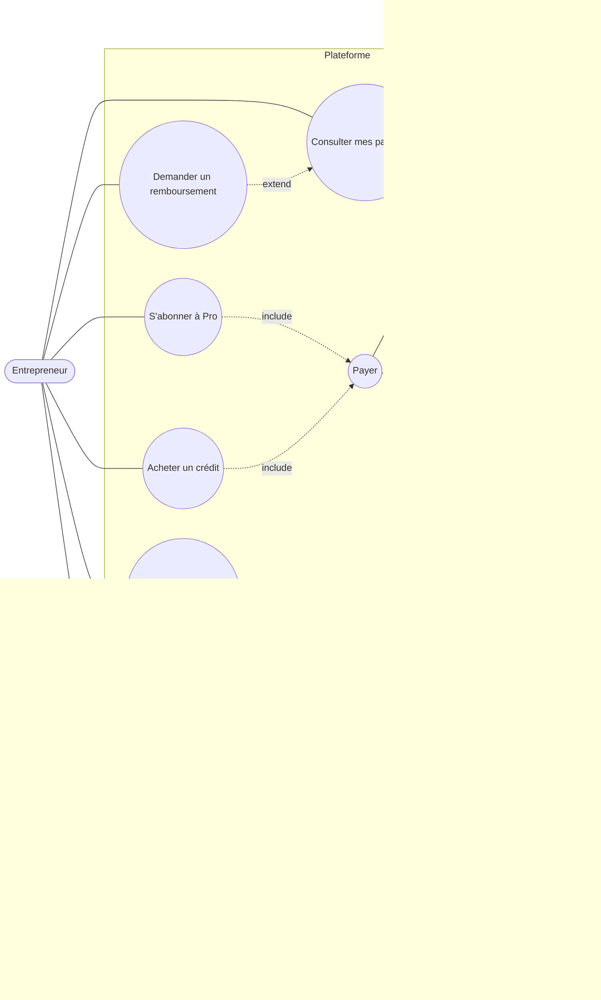
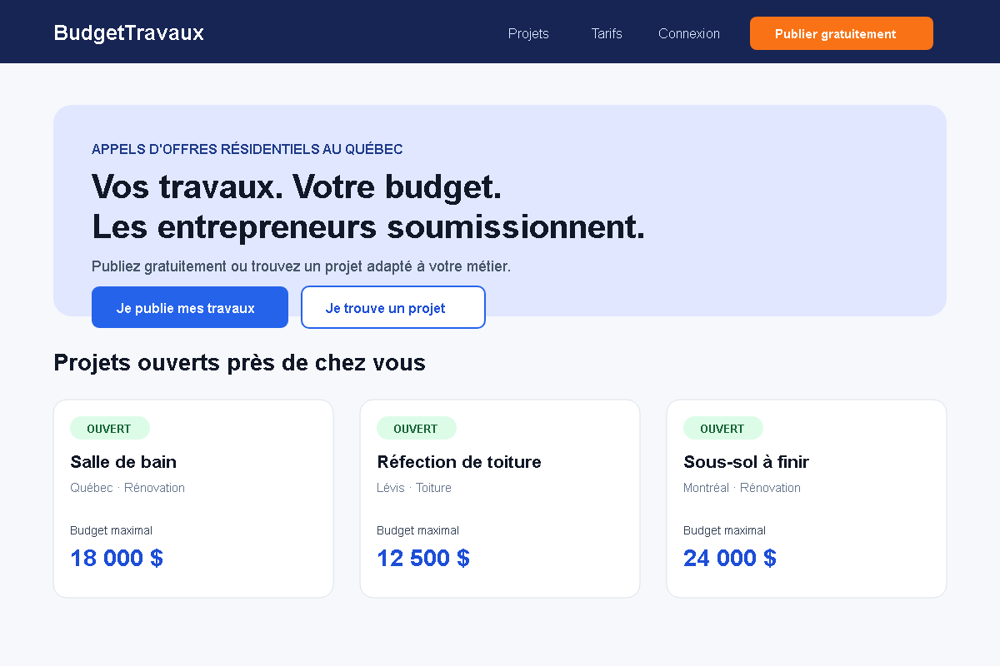
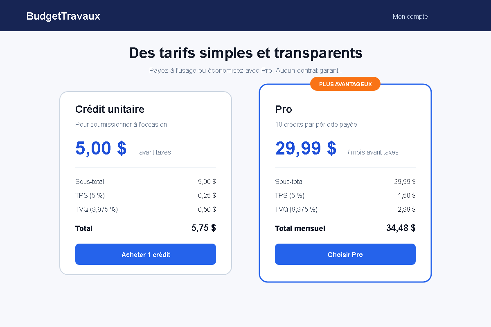
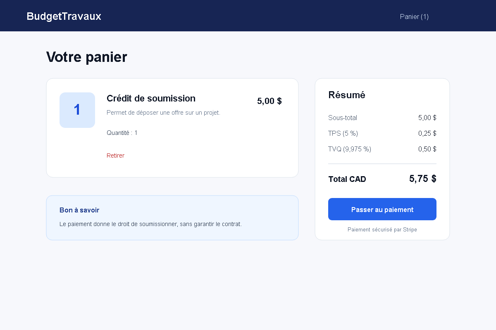
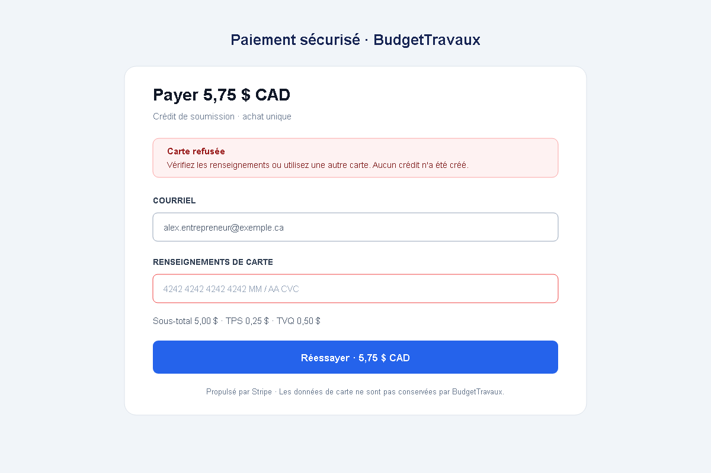
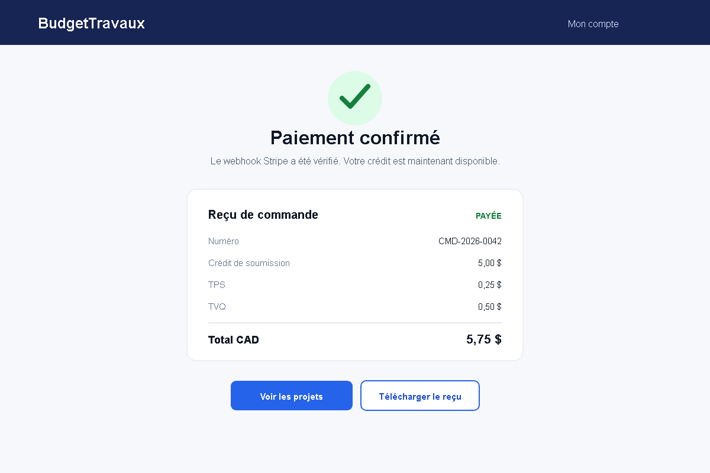
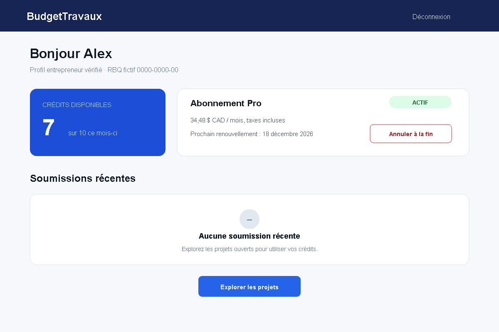
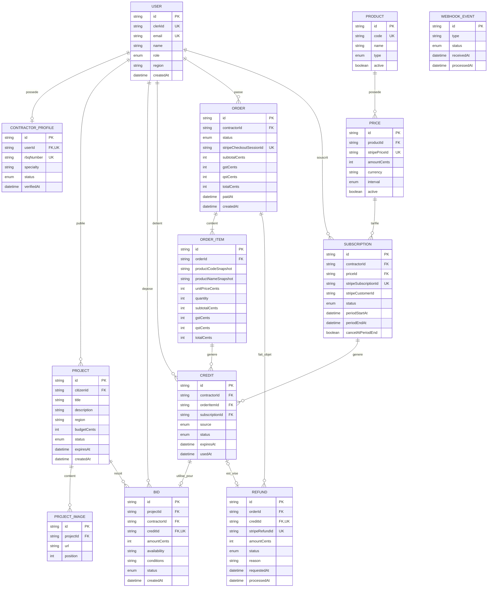

# Cahier des charges — Appel d'offres inversé citoyen

**Plateforme Web transactionnelle pour les travaux résidentiels au Québec**

| Information | Détail |
| --- | --- |
| Cours | 420-951-MA — Applications Web transactionnelles (groupe 25604) |
| Travail | Laboratoire 1 — cahier des charges et modèle de paiement |
| Projet | Option B — nouveau projet |
| Version | 1 |
| Équipe | Eva Besette, Marc-André Dufour et Charles Legault (3 membres) |
| Modèle | Paiement unique de 5 $ par crédit de soumission + abonnement Pro à 29,99 $/mois |
| Technologies | Next.js, TypeScript, Clerk, Prisma, PostgreSQL (Neon), Stripe Checkout |

## 1. Contexte, problème et public cible

### 1.1 Le problème

Quand un citoyen veut rénover sa maison, il doit souvent contacter plusieurs entrepreneurs, répéter son projet et attendre les réponses. Les soumissions reçues peuvent aussi dépasser son budget, ce qui lui fait perdre du temps. De leur côté, les entrepreneurs consacrent du temps et de l'argent à chercher des clients, parfois pour des projets qui ne correspondent pas à leur métier.

Notre plateforme simplifie le processus : le citoyen publie gratuitement ses travaux, ce qu'il aimerait faire et son budget maximal. Par exemple, il peut annoncer une rénovation de salle de bain avec un budget de **18 000 $**. Les entrepreneurs intéressés voient ce montant avant de répondre et peuvent proposer une soumission qui le respecte. Le citoyen compare ensuite les offres et choisit librement son entrepreneur.

**Coûts actuels :** temps passé à contacter des entreprises et à relancer, soumissions au-dessus du budget, difficulté à comparer les offres et dépenses de prospection pour les entrepreneurs. La plateforme facilite le respect du budget annoncé, sans garantir le prix final des travaux.

### 1.2 Public cible

| Segment | Besoin principal | Paiement |
| --- | --- | --- |
| Citoyens propriétaires du Québec | Décrire les travaux et le budget maximal une fois, puis comparer des offres qui respectent ce montant | Gratuit |
| Petits entrepreneurs et travailleurs autonomes du bâtiment | Trouver des projets dans leur région et leur spécialité, avec un budget annoncé | 5 $ par soumission, ou Pro mensuel |

**Périmètre initial :** travaux résidentiels au Québec, interface en français, prix en dollars canadiens. Le budget et les offres de travaux sont comparés en montants totaux, taxes comprises. La plateforme ne prend pas en charge le paiement des travaux ni les éventuels coûts supplémentaires du chantier.

### 1.3 Concurrence (sites officiels consultés le 18 novembre 2026)

| Service | Offre et prix publics | Limite pour notre clientèle |
| --- | --- | --- |
| [Soumission Rénovation](https://soumissionrenovation.ca/fr/accueil) | Service gratuit pour les citoyens; jusqu'à trois soumissions selon le service. Tarif entrepreneur non publié sur cette page. | Mise en relation encadrée : moins de contrôle direct sur un catalogue public de projets. |
| [RénoAssistance](https://www.renoassistance.ca/fr/entrepreneur/faq) | Adhésion entrepreneur gratuite, honoraires en pourcentage **si le projet est gagné**; pourcentage non public. Gratuit pour les propriétaires. | Modèle à commission plutôt qu'un coût connu avant chaque dépôt de soumission. |
| [GoSoumissions](https://gosoumissions.com/entrepreneurs) | Demandes gratuites pour les propriétaires; forfait annuel pour les entrepreneurs, variable selon la région et les services. | Paiement récurrent même si l'entrepreneur veut seulement répondre à quelques projets. |

**Notre positionnement :** une plateforme québécoise simple où les citoyens annoncent leur budget dès le départ et comparent des offres qui le respectent, sans frais de publication ni commission sur les contrats gagnés.

## 2. Vision, SWOT, personas et 7 P

### 2.1 Why / How / What

| | Notre projet |
| --- | --- |
| **Why — Pourquoi** | Aider les citoyens à trouver un entrepreneur qui respecte leur budget et réduire le temps de prospection des entrepreneurs. |
| **How — Comment** | Annonce avec travaux souhaités et budget maximal, recherche par région et métier, soumissions limitées à ce budget et paiement sécurisé pour déposer une offre. |
| **What — Quoi** | Application Web avec comptes, projets et budgets annoncés, soumissions, crédits payants, abonnement Pro et suivi des transactions. |

### 2.2 SWOT

| Forces | Faiblesses |
| --- | --- |
| Publication gratuite avec budget affiché; prix clair de 5 $; offres qui respectent le budget annoncé. | Nouvelle plateforme sans réputation; dépend de la quantité de projets publiés; vérification manuelle des profils au lancement. |

| Opportunités | Menaces |
| --- | --- |
| Citoyens qui cherchent à respecter leur budget; petites entreprises à la recherche de mandats; marché initial limité au Québec. | Concurrents déjà connus; fausses annonces ou faux profils; protection des renseignements personnels et fraude. |

### 2.3 Personas (fictifs)

| | **Marie, 42 ans — citoyenne** | **Alex, 35 ans — entrepreneur** |
| --- | --- | --- |
| Profil | Propriétaire à Québec; veut refaire sa salle de bain avec un budget maximal de 18 000 $. | Petit entrepreneur en rénovation de la région de Québec. |
| Besoin | Expliquer les travaux souhaités une seule fois et recevoir des soumissions dans son budget. | Trouver des projets dans son métier, avec un budget clair avant de soumissionner. |
| Frustration | Attendre des réponses et recevoir des soumissions qui dépassent son budget. | Payer de la publicité ou préparer des offres pour des projets sans budget réaliste. |
| Capacité et volonté de payer | Ne veut pas payer pour publier son projet ni comparer les offres. | Prêt à investir 5 $ pour répondre à un projet intéressant; peut choisir 29,99 $/mois s'il soumissionne souvent. |

### 2.4 Les 7 P

| P | Application au projet |
| --- | --- |
| Produit | Publication de projets avec budget maximal, recherche et comparaison de soumissions respectant ce budget. |
| Prix | Citoyen gratuit; crédit de soumission à 5 $; Pro à 29,99 $/mois pour 10 crédits mensuels. |
| Place (distribution) | Site Web responsive accessible au Québec. |
| Promotion | Réseaux sociaux locaux et présentation de la plateforme aux entrepreneurs. |
| Personnes | Citoyens, entrepreneurs et administration pour la vérification et le soutien. |
| Processus | Publier les travaux et le budget → rechercher → payer ou utiliser un crédit → soumissionner dans le budget → choisir. |
| Preuve physique | Tarifs visibles, confirmation de paiement, historique des offres et reçus. |

## 3. Modèle de paiement

### 3.1 Principe et justification

Le citoyen ne paie jamais pour publier ou comparer. L'entrepreneur peut acheter **un crédit à la fois (paiement unique)** ou prendre **Pro (abonnement mensuel)** s'il répond régulièrement à des projets. Chaque soumission consomme un crédit. Le prix de 5 $ reste accessible pour un usage occasionnel; le plan Pro revient à environ 3 $ par crédit lorsque les 10 sont utilisés. **Le paiement n'assure pas d'obtenir le contrat.**

### 3.2 Grille tarifaire (CAD, avant taxes)

| Fonction / offre | Avant taxes | TPS 5 % | TVQ 9,975 % | Total |
| --- | ---: | ---: | ---: | ---: |
| Publier ou consulter un projet | 0,00 $ | 0,00 $ | 0,00 $ | **0,00 $** |
| Comparer et sélectionner une offre | 0,00 $ | 0,00 $ | 0,00 $ | **0,00 $** |
| Crédit de soumission, 1 unité | 5,00 $ | 0,25 $ | 0,50 $ | **5,75 $** |
| Pro, 10 crédits par mois | 29,99 $ | 1,50 $ | 2,99 $ | **34,48 $/mois** |

**Calcul obligatoire en cents (RM-04).** Crédit : 500 cents × 5 % = 25 cents de TPS; 500 × 9,975 % = 49,875, arrondi à 50 cents de TVQ; **500 + 25 + 50 = 575 cents**. Pro : 2 999 × 5 % = 149,95 → 150 cents; 2 999 × 9,975 % = 299,15025 → 299 cents; **2 999 + 150 + 299 = 3 448 cents**. Les deux taxes sont calculées sur le prix avant taxes, puis arrondies séparément.

| Fonction | Citoyen gratuit | Entrepreneur sans Pro | Entrepreneur Pro |
| --- | --- | --- | --- |
| Publier un projet | Oui | Non | Non |
| Voir les projets ouverts | Oui | Oui | Oui |
| Soumissionner | Non | 1 crédit acheté = 1 offre | 10 crédits par période payée |
| Voir ses offres et paiements | — | Oui | Oui |
| Renouvellement automatique | Non | Non | Oui; résiliable |

Les crédits achetés à l'unité restent disponibles jusqu'à utilisation ou remboursement. Les crédits Pro expirent à la fin de la période payée et ne sont pas reportés. Aucun crédit n'est donné avant confirmation du paiement par webhook Stripe valide (RM-05).

### 3.3 Parcours de paiement et règles

| Parcours | Ce que voit l'utilisateur | Traitement du système et règle |
| --- | --- | --- |
| Achat unique | Panier avec sous-total, deux taxes et total; paiement Stripe; confirmation. | Commande `PENDING`; webhook signé de paiement confirmé → `PAID` et 1 crédit créé (RM-05). |
| Abonnement Pro | Tarif mensuel affiché; paiement Stripe; statut dans le compte. | `invoice.paid` valide → abonnement `ACTIVE` et 10 crédits pour la période; aucun doublon (RM-06). |
| Renouvellement | Nouvelle facture mensuelle et date de période mise à jour. | `invoice.paid` → 10 nouveaux crédits; les anciens crédits Pro expirent. |
| Échec | Message de carte refusée, possibilité de réessayer; aucun faux succès. | Commande non payée, zéro crédit; Pro `PAST_DUE`, accès aux crédits déjà payés jusqu'à la fin de la période courante (RM-07). |
| Annulation | Bouton « Annuler Pro », date de fin indiquée. | Arrêt du prochain renouvellement; accès aux crédits de la période en cours jusqu'à sa fin, puis `CANCELED`. |
| Remboursement | Demande depuis l'historique, statut de la demande. | Crédit **acheté à l'unité, inutilisé** : demande possible dans les 14 jours de l'achat, traitée par un administrateur; Stripe confirme le remboursement avant `REFUNDED` et retrait du crédit (RM-08). Crédit déjà utilisé : pas de remboursement automatique. Les droits légaux applicables demeurent prioritaires. |

Le paiement des travaux se fait **directement entre le citoyen et l'entrepreneur**, hors de la plateforme. Stripe sera utilisé **en mode test** pendant le cours.

### 3.4 Webhooks utiles

| Événement Stripe | Action |
| --- | --- |
| `checkout.session.completed` avec `payment_status=paid` | Confirmer la commande à paiement unique et créer le crédit une seule fois. |
| `checkout.session.expired` | Mettre la commande toujours en attente à `CANCELED`. |
| `invoice.paid` | Activer/renouveler Pro et ajouter 10 crédits pour cette facture. |
| `invoice.payment_failed` | Passer l'abonnement en `PAST_DUE`; inviter à mettre à jour le paiement. |
| `customer.subscription.updated` / `deleted` | Synchroniser l'annulation ou le statut. |
| `charge.refunded` | Mettre à jour le remboursement confirmé et retirer tout crédit inutilisé concerné. |

Pour chaque événement : vérifier la signature Stripe, enregistrer son identifiant dans `WebhookEvent` et traiter l'opération en transaction. Une redirection réussie dans le navigateur ne suffit **jamais** à rendre une commande payée.

## 4. User stories et critères d'acceptation

### 4.1 Backlog priorisé (MoSCoW)

| ID | User story | Priorité |
| --- | --- | --- |
| US-01 | En tant que citoyen ou entrepreneur, je veux créer un compte et me connecter afin de retrouver mes informations. | Must |
| US-02 | En tant que citoyen, je veux publier les travaux souhaités, mes photos, ma région et mon budget maximal afin de recevoir des offres qui respectent mes moyens. | Must |
| US-03 | En tant que citoyen, je veux ajuster mon projet avant la première offre ou le fermer au besoin afin de garder ses informations à jour. | Must |
| US-04 | En tant qu'entrepreneur, je veux filtrer les projets par région et métier et voir leur budget afin de trouver ceux qui me conviennent. | Must |
| US-05 | En tant qu'entrepreneur, je veux remplir mon profil et fournir mon numéro RBQ afin de pouvoir soumissionner après vérification. | Must |
| US-06 | En tant qu'entrepreneur, je veux acheter un crédit à 5 $ afin de déposer une soumission. | Must |
| US-07 | En tant qu'entrepreneur, je veux déposer une offre avec un prix qui respecte le budget annoncé et mes disponibilités afin de proposer mes services. | Must |
| US-08 | En tant que citoyen, je veux comparer les soumissions reçues dans mon budget afin de choisir un entrepreneur. | Must |
| US-09 | En tant que citoyen, je veux attribuer mon projet à un entrepreneur afin de fermer l'appel d'offres. | Must |
| US-10 | En tant qu'entrepreneur, je veux voir le prix, la TPS, la TVQ et le total avant de payer afin de connaître le coût exact. | Must |
| US-11 | En tant qu'entrepreneur régulier, je veux m'abonner à Pro afin d'obtenir 10 crédits par mois. | Must |
| US-12 | En tant qu'abonné, je veux voir l'état de mon abonnement et l'annuler afin de contrôler mes renouvellements. | Must |
| US-13 | En tant qu'entrepreneur, je veux consulter mes achats et demander le remboursement d'un crédit admissible afin de suivre mes dépenses. | Should |
| US-14 | En tant qu'entrepreneur, je veux recevoir un avis lorsqu'un projet correspond à mon métier afin de ne pas manquer une occasion. | Could |

**Won't (cette session) :** gestion du paiement des travaux, contrats électroniques, application mobile native, abonnements annuels et messagerie en temps réel.

### 4.2 Critères d'acceptation (testables)

- **CA-01 — US-02 :** Étant donné un citoyen connecté, quand il publie sa rénovation de salle de bain avec les travaux souhaités, la région et un budget maximal de 18 000 $ (photos facultatives), alors le projet `OPEN` affiche ce budget aux entrepreneurs.
- **CA-02 — US-02 :** Étant donné un budget nul ou négatif, quand il soumet le formulaire, alors le serveur refuse l'enregistrement avec un message clair.
- **CA-03 — US-04 :** Étant donné trois projets de métiers différents, quand l'entrepreneur filtre « toiture », alors seuls les projets de toiture ouverts s'affichent avec leur budget maximal.
- **CA-04 — US-05 :** Étant donné un profil non vérifié, quand l'entrepreneur essaie de soumissionner, alors l'action est refusée sans consommer de crédit.
- **CA-05 — US-10 :** Étant donné un crédit de 5,00 $, quand il ouvre le panier, alors il voit TPS 0,25 $, TVQ 0,50 $ et total 5,75 $.
- **CA-06 — US-06 :** Étant donné une commande en attente, quand un webhook Stripe signé confirme le paiement, alors la commande devient `PAID` et un seul crédit est ajouté.
- **CA-07 — US-06 :** Étant donné une carte refusée ou une session expirée, quand le paiement échoue, alors la commande n'est pas payée et aucun crédit n'est ajouté.
- **CA-08 — US-06 :** Étant donné le même webhook reçu deux fois, quand le serveur le traite, alors aucun deuxième crédit n'est créé.
- **CA-09 — US-07 :** Étant donné un entrepreneur vérifié ayant un crédit et un projet avec un budget maximal de 18 000 $, quand il dépose une offre de 17 500 $, alors le crédit passe à `USED` et l'offre est enregistrée une fois.
- **CA-10 — US-07 :** Étant donné un entrepreneur ayant déjà soumis au même projet, quand il recommence, alors l'offre supplémentaire est refusée sans retirer un crédit.
- **CA-11 — US-09 :** Étant donné un projet ouvert avec deux offres respectant le budget maximal, quand son propriétaire en choisit une, alors le projet passe à `AWARDED` et n'accepte plus de nouvelles offres.
- **CA-12 — US-11 :** Étant donné une facture Pro payée et un webhook valide, quand le serveur la traite, alors 10 crédits sont associés à cette période, même si Stripe renvoie l'événement.
- **CA-13 — US-12 :** Étant donné un abonnement annulé pour la fin de période, quand la date de fin est atteinte, alors aucun renouvellement ni nouveau crédit n'est accordé.
- **CA-14 — US-13 :** Étant donné un crédit déjà utilisé, quand l'entrepreneur demande un remboursement automatique, alors le système le refuse et explique pourquoi.
- **CA-15 — US-07 :** Étant donné un projet avec un budget maximal de 18 000 $, quand l'entrepreneur tente d'envoyer une offre de 19 000 $, alors le dépôt est refusé, le budget maximal est rappelé et aucun crédit n'est consommé.

### 4.3 Règles métier

| ID | Règle |
| --- | --- |
| RM-01 | Un citoyen publie gratuitement; seuls les entrepreneurs vérifiés peuvent déposer des offres. |
| RM-02 | Un projet `OPEN` accepte des offres; `AWARDED` ou `CLOSED` n'en accepte plus. |
| RM-03 | Une seule offre par entrepreneur et par projet; un crédit est consommé au dépôt réussi. |
| RM-04 | Tous les montants sont des entiers en cents; TPS et TVQ sont arrondies séparément. |
| RM-05 | Une commande ne passe à `PAID` qu'après un webhook Stripe signé et vérifié. |
| RM-06 | Une facture Pro payée donne exactement 10 crédits pour sa période, sans duplication. |
| RM-07 | Un paiement échoué ne donne aucun crédit; les crédits d'une période déjà payée restent valides jusqu'à sa fin. |
| RM-08 | Un crédit unitaire inutilisé peut faire l'objet d'une demande de remboursement dans les 14 jours; décision et confirmation Stripe enregistrées. |
| RM-09 | Le citoyen propriétaire du projet est le seul à pouvoir attribuer ou fermer son projet. |
| RM-10 | Un entrepreneur ne peut pas soumissionner sur son propre projet ni sur un projet expiré. |
| RM-11 | Les crédits Pro non utilisés expirent à la fin de la période payée; ils ne sont pas reportés. |
| RM-12 | L'adresse précise et les coordonnées privées ne sont pas publiques dans la liste des projets. |
| RM-13 | Le budget maximal du projet est positif et visible aux entrepreneurs avant qu’ils soumissionnent. Une offre dont le prix total dépasse ce montant est refusée sans consommer de crédit. Le budget ne peut plus être changé après la première offre. |

### 4.4 Cas d'utilisation

Acteurs : **citoyen**, **entrepreneur**, **administrateur**, **Stripe** (service externe). Le diagramme détaillé est aussi dans [docs/cas-utilisation.md](cas-utilisation.md).

**Dépôt d'une soumission :** l'entrepreneur voit la description et le budget maximal avant d'utiliser son crédit. Si le prix soumis dépasse ce budget, le dépôt est refusé sans consommer de crédit (RM-13).

**UC-08 — Payer :** acteur entrepreneur, service externe Stripe. **Préconditions :** compte connecté, panier valide, produit disponible et prix recalculé au serveur. **Scénario :** (1) l'entrepreneur choisit crédit ou Pro; (2) le système affiche les taxes et crée une commande `PENDING`; (3) Stripe Checkout reçoit le paiement; (4) le webhook signé est vérifié; (5) une transaction en base passe la commande à `PAID` et crée le crédit, ou active Pro après `invoice.paid`; (6) le compte affiche le crédit disponible. **Échecs :** carte refusée ou session abandonnée : aucun crédit; webhook en double : aucune deuxième attribution; signature invalide : rejet HTTP 400. **Postcondition :** paiement confirmé et droit accordé une seule fois, ou aucun changement si le paiement a échoué.

## 5. Diagrammes de classes et de séquence

Les diagrammes Mermaid détaillés sont conservés dans [classes.md](classes.md). Ils présentent les attributs typés, les multiplicités, les montants en cents et la séquence complète du paiement avec webhook signé et traitement idempotent.

## 6. Maquettes

Les maquettes sont des écrans Web responsive de fidélité moyenne. Les montants sont toujours affichés en dollars canadiens; le serveur demeure la source de vérité pour les calculs. Les six images sont conservées dans `maquettes/`.

| Écran | Objectif | État prévu |
| --- | --- | --- |
| [Accueil](maquettes/accueil.png) | Expliquer la proposition de valeur et diriger chaque rôle vers son parcours. | Trois projets fictifs ouverts et appel à l'action. |
| [Tarifs](maquettes/tarifs.png) | Comparer le crédit unitaire et Pro. | Prix avant taxes, TPS, TVQ et total visibles. |
| [Panier](maquettes/panier.png) | Vérifier le produit choisi avant Stripe. | Sous-total 5,00 $, TPS 0,25 $, TVQ 0,50 $, total 5,75 $. |
| [Paiement](maquettes/paiement.png) | Payer dans Stripe Checkout. | Exemple d'erreur « Carte refusée » sans faux succès. |
| [Confirmation](maquettes/confirmation.png) | Confirmer le paiement après traitement du webhook. | Commande payée, reçu et crédit disponible. |
| [Compte et abonnement](maquettes/compte-abonnement.png) | Suivre crédits, Pro, paiements et annulation. | État vide pour les soumissions récentes. |

### 6.1 Accueil

### 6.2 Tarifs

### 6.3 Panier

### 6.4 Paiement — état d'erreur

### 6.5 Confirmation

### 6.6 Compte et abonnement — état vide

## 7. Schéma de données

### 7.1 Schéma relationnel

`WebhookEvent` est volontairement indépendant : son `id` est l'identifiant Stripe et sert de verrou d'idempotence avant toute mutation financière.

### 7.2 États et intégrité

| Élément | Valeurs prévues | Règle d'intégrité |
| --- | --- | --- |
| `User.role` | `CITIZEN`, `CONTRACTOR`, `ADMIN` | Les autorisations sont validées côté serveur. |
| `Project.status` | `DRAFT`, `OPEN`, `AWARDED`, `CLOSED`, `EXPIRED` | Seul `OPEN` accepte une soumission (RM-02). |
| `Bid.status` | `SUBMITTED`, `ACCEPTED`, `REJECTED`, `WITHDRAWN` | Unique sur `(projectId, contractorId)`; montant positif et au plus égal au budget (RM-03, RM-13). |
| `Credit.status` | `AVAILABLE`, `USED`, `EXPIRED`, `REFUNDED` | Un crédit `AVAILABLE` est consommé dans la même transaction que la création de l'offre. |
| `Order.status` | `PENDING`, `PAID`, `CANCELED`, `REFUNDED` | `PAID` seulement après un webhook signé (RM-05). |
| `Subscription.status` | `INCOMPLETE`, `ACTIVE`, `PAST_DUE`, `CANCELED` | Une facture payée donne 10 crédits une seule fois (RM-06). |
| `Refund.status` | `REQUESTED`, `APPROVED`, `REJECTED`, `SUCCEEDED`, `FAILED` | Le crédit unitaire doit être inutilisé et acheté depuis au plus 14 jours (RM-08). |
| `WebhookEvent.status` | `RECEIVED`, `PROCESSED`, `FAILED`, `IGNORED` | La clé primaire Stripe empêche le retraitement. |

### 7.3 Contraintes et index attendus dans Prisma

- Tous les prix, taxes, budgets et offres utilisent `Int` avec le suffixe `Cents`; aucun `Float` ni `Decimal`.
- `OrderItem` conserve le code, le nom, le prix unitaire et les taxes au moment de l'achat, même si `Price` change plus tard.
- `onDelete: Restrict` protège les utilisateurs, commandes, lignes, abonnements, crédits, offres et remboursements ayant une valeur d'audit.
- Index sur chaque clé étrangère et sur les recherches fréquentes : `Project(status, region)`, `Project(status, expiresAt)`, `Bid(projectId, status)`, `Credit(contractorId, status, expiresAt)`, `Order(contractorId, createdAt)` et `Subscription(contractorId, status)`.
- Contraintes uniques : `(projectId, contractorId)`, `Bid.creditId`, les identifiants Stripe et `WebhookEvent.id`.
- La première migration doit ajouter au minimum les contraintes SQL `CHECK (budget_cents > 0)`, `CHECK (amount_cents > 0)` et une contrainte ou un déclencheur garantissant qu'une offre ne dépasse pas le budget du projet. Cette dernière règle est aussi vérifiée dans la transaction applicative avant de consommer un crédit (RM-13).
- Les opérations sensibles sont atomiques : traitement du webhook, attribution des crédits, consommation du crédit avec création de l'offre, attribution du projet et remboursement.

## 8. Exigences non fonctionnelles

| ID | Exigence mesurable |
| --- | --- |
| ENF-01 | Aucune donnée de carte bancaire conservée; paiement sur Stripe Checkout; tous les webhooks vérifiés avec le secret Stripe. |
| ENF-02 | Aucun secret dans Git; `.env` ignoré et l'agent IA ne peut pas lire ce fichier. |
| ENF-03 | Les pages de consultation principales doivent répondre en moins de 2 secondes au 95e percentile dans un test local avec 100 projets fictifs, hors temps réseau externe. |
| ENF-04 | Les données personnelles collectées sont limitées au nom, courriel, région et informations professionnelles nécessaires; les citoyens doivent consentir à la politique de confidentialité avant publication. |
| ENF-05 | Les demandes de suppression sont traitées sous 30 jours, sauf les données devant être conservées pour la comptabilité ou une obligation légale; la règle de conservation finale sera documentée avant production. |
| ENF-06 | Les accès par rôle sont vérifiés côté serveur; tests pour empêcher un entrepreneur de modifier un projet qui ne lui appartient pas. |
| ENF-07 | Une répétition du même webhook ou deux dépôts simultanés ne doit jamais créer un deuxième crédit ni consommer deux fois le même crédit. |
| ENF-08 | Le montant d'une soumission est vérifié côté serveur avant la consommation d'un crédit; une offre au-dessus du budget est rejetée (RM-13). |

**Loi 25 et hébergement :** la base prévue est chez Neon (région à déterminer; souvent AWS US East, **hors Québec**). Avant toute mise en production, vérifier la région réelle, désigner une personne responsable de la protection des renseignements personnels, réaliser l'évaluation des facteurs relatifs à la vie privée requise pour la communication hors Québec, publier la politique de confidentialité et fixer les durées de conservation. Pour le laboratoire, seules des données fictives sont utilisées.

## 9. Planification et répartition

| Étape | Livrable et stories liées |
| --- | --- |
| Semaine 1 — Laboratoire 1 | Cahier, maquettes, diagrammes, règles métier et schéma Prisma (US-01 à US-14). |
| Semaine 2 — Laboratoire 2 | Comptes, projets, filtres et début du panier (US-01 à US-05, US-10). |
| Semaine 3 — Laboratoire 3 | Stripe Checkout, webhooks, crédits et Pro (US-06, US-07, US-11, US-12). |
| Semaine 4 — finalisation | Comparaison, attribution, historique, tests de refus et présentation (US-08, US-09, US-13). |

**Répartition des rôles :**

| Membre | Responsabilités | Stories |
| --- | --- | --- |
| Eva Besette | À déterminer | À déterminer |
| Marc-André Dufour | À déterminer | À déterminer |
| Charles Legault | À déterminer | À déterminer |

Chaque membre fait ses commits avec son propre compte Git.

## 10. Technologies choisies

| Élément | Choix et raison |
| --- | --- |
| Front-end / back-end | **Next.js (App Router) et TypeScript** : un seul projet pour pages et routes API; conforme aux démonstrations du cours. |
| Base de données | **PostgreSQL (Neon)** : données relationnelles et transactions fiables. |
| ORM | **Prisma** : schéma typé et migrations. |
| Authentification | **Clerk** : inscription, connexion et gestion des sessions; contrôle des rôles citoyen et entrepreneur côté serveur. |
| Paiement | **Stripe Checkout et webhooks** en mode test; aucune donnée de carte hébergée par nous. |
| Tests | Vitest pour taxes et règles métier; tests d'intégration pour crédits et webhooks. |

## 11. Utilisation de l'IA

## 12. Cohérence et traçabilité

Les identifiants `US-xx`, `CA-xx`, `RM-xx` et `ENF-xx` sont réutilisés dans le cahier, les diagrammes, l'agent et, plus tard, les tests. Le budget et les soumissions sont comparés en cents (RM-13, CA-09, CA-15). Les commits suivront `type: description`, par exemple `docs: RM-05 préciser la confirmation des paiements`. Chaque changement au modèle de paiement devra être reflété dans la grille, les tests, les écrans et le schéma.

### Sources de vérification

- [Revenu Québec — Calcul de la TPS et de la TVQ](https://www.revenuquebec.ca/fr/entreprises/taxes/tpstvh-et-tvq/perception-de-la-tps-et-de-la-tvq/calcul-des-taxes/)
- [Soumission Rénovation — Accueil](https://soumissionrenovation.ca/fr/accueil)
- [RénoAssistance — FAQ entrepreneurs](https://www.renoassistance.ca/fr/entrepreneur/faq)
- [GoSoumissions — Entrepreneurs](https://gosoumissions.com/entrepreneurs)
- [Office de la protection du consommateur — Avant d'engager un entrepreneur](https://www.opc.gouv.qc.ca/consommateur/bien-service/habitation-renovation/renovation/conseils/entrepreneur)
