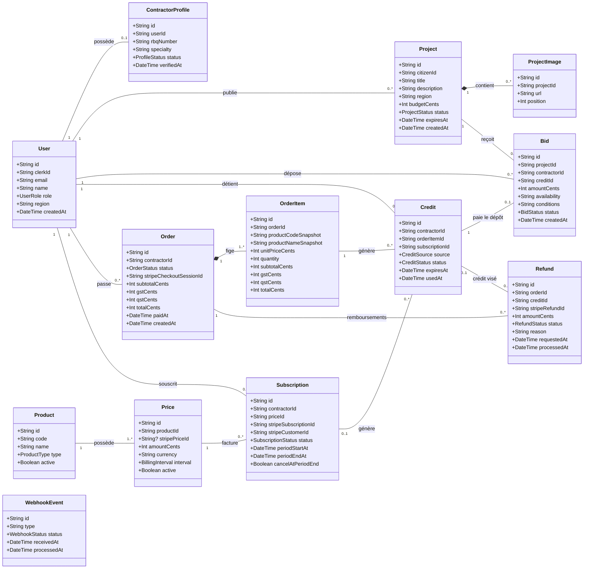
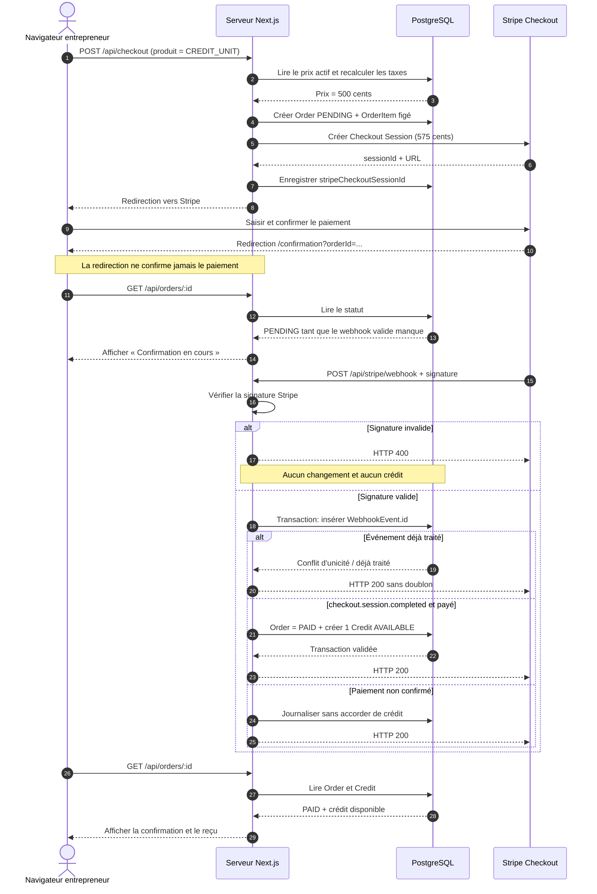

# Diagrammes de classes et de séquence

[Retour au cahier des charges](cahier-des-charges.md#5-diagrammes-de-classes-et-de-séquence)

Les deux diagrammes suivants couvrent le cœur métier et le paiement. Tous les montants sont des entiers en cents (RM-04). Les relations avec une commande sont conservées afin de garder un historique comptable; elles ne doivent pas être supprimées en cascade.

## 1. Diagramme de classes

**Contraintes structurantes :** une seule soumission par couple `(projectId, contractorId)` (RM-03); une seule utilisation par `creditId`; `stripePriceId` est optionnel et unique lorsqu'il existe, puisque Checkout utilisera `price_data`; `stripeCheckoutSessionId`, `stripeSubscriptionId` et `stripeRefundId` sont uniques; `WebhookEvent.id` est l'identifiant Stripe sans valeur générée; une offre doit respecter `amountCents <= Project.budgetCents` (RM-13).

## 2. Diagramme de séquence — achat d'un crédit

Le même principe s'applique à Pro : seul un `invoice.paid` signé crée les 10 crédits de la période. L'unicité de `WebhookEvent.id` et de la facture Stripe empêche toute double attribution (RM-06, ENF-07).
